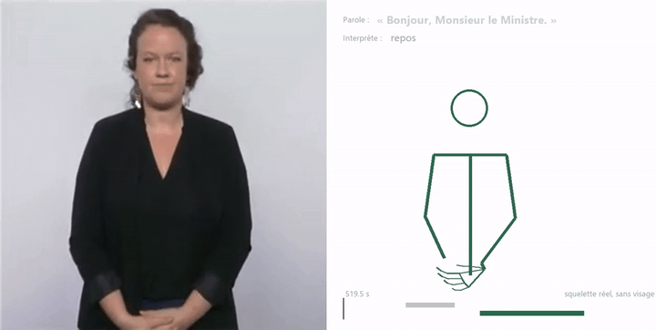

# SignaCulture AI

Studio local de recherche pour explorer du texte français, des mouvements LSF capturés et un avatar 3D. Le lecteur fonctionne avec des vidéos réelles ; la traduction générale français → LSF n’est pas résolue.

**[Premier prototype en ligne — en cours de développement](https://forum.yassinejemmali.me/)** : cette version n’est pas encore finalisée ; certaines fonctionnalités restent expérimentales.

### Démonstration vidéo

La vidéo ci-dessous montre la vidéo source et le squelette suivi. Cliquez sur l’aperçu pour ouvrir la vidéo MP4 complète.

[](artifacts/demos/comparaison_video_squelette.mp4)

[Ouvrir ou télécharger la vidéo MP4](artifacts/demos/comparaison_video_squelette.mp4).

## Essayer

```bash
make setup
python3 scripts/setup-avatar.py   # personnage local pour revue, voir docs/AVATAR_PROVENANCE.md
bash scripts/setup-models.sh all   # capture MediaPipe et emotion2vec local, téléchargements explicites
make dev
```

Ouvrir **http://127.0.0.1:5173**. Dans Studio, essayer « Bonjour ». Bibliothèque permet de sélectionner un mouvement, de comparer sa vidéo source et de télécharger un aperçu WebM. Capturer accepte une vidéo autorisée, un JSON de mouvements ou un export de landmarks Animics. Recherche affiche les expériences terminées et permet d’interroger les checkpoints locaux.

La session actuelle contient **1 447 mouvements réels** : 1 007 captures Dicta-Sign acceptées et les 440 mouvements précédents. **Les 1 025 vidéos LSF publiques du portail Dicta-Sign ont été téléchargées et capturées** ; 18 restent hors lookup pour revue du suivi. Le [pipeline Dicta-Sign → glosses → poses](docs/DICTASIGN_PIPELINE.md) fournit les commandes, les résultats vérifiés et le diagramme. Dans Studio, essayer **Bonjour merci**, puis ouvrir **Exporter la chaîne glosses → poses** pour obtenir un `.pose` standard et une vidéo squelette via le véritable moteur upstream.

## Voir la bibliothèque des mots et signes

Lancer l’application avec `make dev`, ouvrir **http://127.0.0.1:5173**, puis choisir **Bibliothèque** dans le menu de Studio. La recherche filtre les concepts français ; chaque entrée permet de consulter la glose, la source et le mouvement associé.

Pour parcourir les listes sources directement : [catalogue lexical Dicta-Sign — 1 025 références vidéo, dont 1 007 captures admises](data/source_inventory/dictasign_lsf.json) et [inventaire des signes LSF de Wikimedia Commons — 447 entrées](data/source_inventory/commons_lsf.json). Les captures en revue qualité ne sont pas disponibles dans la bibliothèque consultable.

Les vidéos et dérivés restent locaux dans `.runtime/`. Sur un nouveau checkout, seul Bonjour est livré ; pour reconstruire les captures Dicta-Sign :

```bash
.venv/bin/pip install -r scripts/requirements-data.txt
.venv/bin/python scripts/ingest_dictasign.py --all --workers 2 --capture-workers 4
integration/spoken_pipeline/setup.sh
```

Le corpus Commons antérieur se reconstruit séparément :

```bash
.venv/bin/python scripts/ingest_commons_signs.py --all --author-mirror --workers 2
```

L’inventaire contient 447 concepts France-LSF avec licences par fichier, crédits et sommes de contrôle. Toutes les vidéos ont été récupérées dans cette session. Sept captures échouent au seuil technique de suivi des mains et restent hors bibliothèque. Le [rapport d’ingestion](data/source_inventory/ingestion_report.json) précise les critères. Une capture admise par ce seuil n’est pas une validation linguistique.

## Ce qui fonctionne

- Indexation de concepts avec lemmatisation française spaCy lorsqu’installée, expressions les plus longues et inconnus explicites. Ce lookup ne traduit pas la grammaire LSF.
- Extraction MediaPipe du corps, des doigts et de quelques mesures faciales. Les occultations restent visibles ; profondeur et retargeting sont approximatifs.
- Avatar articulé Three.js : IK des bras, orientation des paumes, os des doigts, longueurs préservées. Liaisons quintiques de 333 ms entre clips, timeline, comparaison avec la source et vrai export WebM avec filigrane et attribution. Le modèle local de revue et ses limites sont décrits dans [la provenance](docs/AVATAR_PROVENANCE.md).
- Décodage audio/vidéo FFmpeg, estimation F0, RMS et pauses. Synchronisation approximative aux portions voisées, sans alignement mot à mot.
- Inférence locale emotion2vec, affichée comme hypothèse. Les signaux faciaux capturés priment sur la modulation expressive expérimentale.
- Catalogue SQLite séparant vidéos lexicales, annotations et paires de recherche ; provenance, licences, splits et évaluations conservés.

## Composition assistée et revue

Dans Studio, ouvrir « Préparer et corriger les concepts ». On peut sélectionner les signes réels, les réordonner, prévisualiser la sélection et télécharger une fiche JSON pour une revue linguistique. Ces fiches restent des brouillons, jamais des données expertes automatiquement approuvées. Le modèle de proposition Qwen a été retiré à la demande de l’utilisateur. La sélection reste manuelle, avec recherche dans le dictionnaire français et sens non représenté explicite.

## Vérification

```bash
make test
CHROME_PATH=/chemin/vers/chrome npm --prefix e2e test
CHROME_PATH=/chemin/vers/chrome npm --prefix e2e run test:dictasign
# Environnement ML séparé, avec dépendances training installées :
.worktrees/wt-codex2/training/.venv-train/bin/python -m pytest training/test_catalog.py training/test_adaptation.py
```

76 tests API/schémas/mouvement et 24 tests de recherche passent, avec des vérifications frontend des transitions et du rig. Les [améliorations mesurées de l’avatar](docs/AVATAR_PLAYBACK.md) stabilisent les doigts, corrigent l’échelle des sourcils et limitent certaines collisions ; les cas résiduels sont documentés. Un test strictement marqué xfail conserve le défaut connu de détection du prénom Alice. Le contrôle navigateur couvre composition, recherche temporelle, téléchargement réel, audio, import, persistance, mobile et erreurs réseau. Les [captures et aperçu vidéo](artifacts/README.md) documentent le logiciel exécuté.

Les modèles `.models/`, environnements, checkpoints et captures `.runtime/` sont ignorés par Git. Aucun téléchargement automatique n’a lieu lors d’une requête API. Le modèle français optionnel se configure dans [backend/README.md](backend/README.md).

Développement : exactement deux worktrees, racine `main` pour le lead et `.worktrees/wt-codex2` pour `codex2`, GPT-6.1 Sol medium. Voir [l’organisation](docs/team_worktree_organization.md). L’API reste locale : le système de revue n’est pas un service d’authentification. La publication d’une traduction reste bloquée sans validation réelle.

## Réparation après revue du papier

Le [diagnostic](research/FAILURE_ANALYSIS_AND_REPAIR.md) distingue les erreurs du prototype des composants manquants. Les fixtures synthétiques sont exclues du lookup normal ; les clips réels conservent leurs deux extrémités et disposent d’une liaison de 333 ms ; le personnage est articulé avec IK et doigts. Le [CGAN entraîné](research/TRANSITION_REPORT.md) améliore légèrement la reconstruction intra-signe, sans démontrer la coarticulation inter-signes. Les données originales du papier et la validation linguistique restent manquantes.
