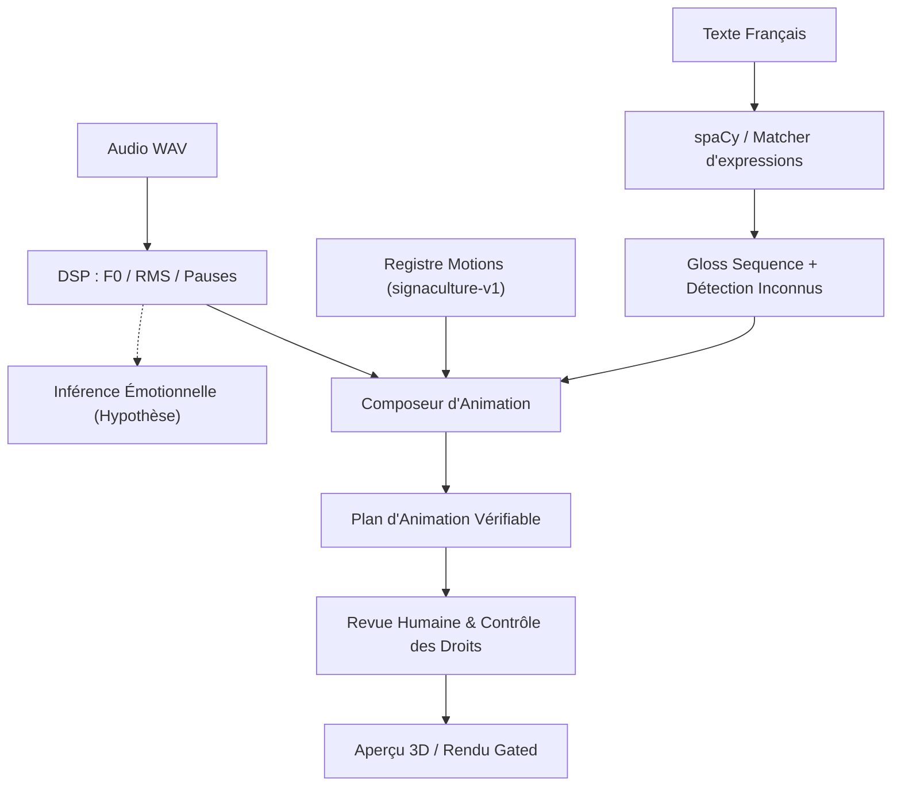

# Méthodologie Scientifique et Technique — SignaCulture AI

> **Document :** Spécification méthodologique v1.0  
> **Cadre :** Hackathon IA Éthique 360  
> **Avertissement :** Ce document détaille l'architecture expérimentale et le protocole d'évaluation. Les étapes d'ablation perceptuelle sur signants humains sont programmées pour la phase de consolidation.

---

## 1. Vue d'Ensemble du Pipeline

SignaCulture AI orchestre une chaîne modulaire découplée permettant de passer d'un texte français (avec signal audio optionnel) à une animation 3D intelligible et contrôlée :

---

## 2. Décomposition des Modules

### 2.1 Traitement Textuel et Lookup de Glosses (Text-to-Gloss)
- **Tokenisation & Lemmatisation :** Réalisées via spaCy (`fr_core_news_sm`) pour normaliser les formes fléchies en concepts canoniques.
- **Priorité aux expressions figées :** Un matcher multi-termes examine d'abord les locutions complexes (ex. "s'il vous plaît") avant de résoudre les lemmes isolés.
- **Gestion des Inconnus (`unknowns`) :** Toute unité lexicale non couverte par le registre restreint est isolée. La réponse API stipule impérativement `translation_validated: false` et `linguistic_review: "pending"`.
- **Règle scientifique :** La lemmatisation n'est pas une traduction syntaxique en LSF. Elle sert uniquement d'indexeur de concepts pour des tests contrôlés.

### 2.2 Analyse Acoustique et Prosodique
- **Signal déterministe (DSP) :** Analyse par fenêtrage de 50 ms (recouvrement de 25 ms) :
  - **Énergie RMS :** Détection de l'intensité vocale et des pauses silencieuses.
  - **Fréquence fondamentale (F0) :** Estimation de la hauteur vocale (testée sur des tons purs 220 Hz et 440 Hz).
  - **Horodatage temporel :** Mesures fournies en millisecondes pour un alignement précis avec les segments gestuels.
- **Couche Affective (expérimentale) :** le checkpoint local `emotion2vec_plus_seed` (poids vérifiés, voir `research/audio/EMOTION2VEC_WEIGHT_AUDIT.md`) produit sur demande `emotion_hypothesis` (9 catégories pour tout le clip) et `emotion_timeline` (fenêtres de 2 s, pas de 1 s, fenêtres silencieuses ignorées). Ces scores sont des hypothèses du modèle, sans mesure d'exactitude ni calibration en français ; `null` lorsque le modèle est absent ou non demandé.
- **Visage de l'avatar :** `frontend/src/utils/emotionFace.ts` convertit les scores en blendshapes ARKit (joie → sourire, pommettes ; tristesse → coins de bouche abaissés, `browInnerUp` ; colère → `browDown`, `noseSneer` ; surprise, peur, dégoût), avec un seuil de bruit (15 %), un lissage (~300 ms) et une intensité réglable. Au repos, visage complet. Pendant les signes, bas du visage plafonné à 0,35, `jawOpen` laissé aux données capturées, et sourcils seulement nuancés de façon additive (≤ 0,1) au-dessus des sourcils grammaticaux capturés ; la rotation de la tête n'est jamais modifiée.

### 2.3 Bibliothèque de Mouvements et Rig `signaculture-v1`
- **Spécification du Rig :** Hiérarchie squelettique normalisée :
  - `head`, `neck`, `hips`
  - `left_shoulder`, `left_elbow`, `left_wrist`
  - `right_shoulder`, `right_elbow`, `right_wrist`
- **Repère :** Coordonnées métriques (Y vers le haut, X vers la droite, Z vers l'avant).
- **Interpolation :** Interpolation linéaire des positions et sphérique (SLERP) des rotations articulaires entre images clés pour éviter les saccades lors du raccordement des segments.

---

## 3. Références et limites de comparaison

L'article [Dicta-Sign-LSF-v2 (Belissen et al., LREC 2020)](https://aclanthology.org/2020.lrec-1.740/) présente un corpus de dialogues LSF et une baseline de reconnaissance. Il constitue une référence pour les données et leurs annotations ; il ne valide pas notre synthèse gestuelle.

Le plan fourni décrit aussi un travail nommé *Signing Avatar Synthesis via a Hybrid T5-GAN Approach*. Le document intégral correspondant n'est pas présent dans ce dépôt et n'a pas été examiné durant cette implémentation. Aucune attribution d'auteur, comparaison de performances ou conclusion sur ses droits et sa gouvernance n'est donc revendiquée ici.

L'état réel de SignaCulture est un lecteur de positions 3D avec six fixtures synthétiques, une recherche de concepts contrôlés et une analyse audio indépendante. La mise en correspondance linguistique des segments audio avec les gestes, l'adaptation automatique du rythme et l'évaluation de l'intelligibilité restent à réaliser. Le curseur expressif est une expérience manuelle d'amplitude, sans garantie linguistique.

---

## 4. Protocole d'Évaluation Expérimentale (Ablation E1 à E5)

Le plan de validation prévoit 5 expériences comparatives :

- **E1 — Lookup de Gloss :** Comparaison lemmatisation simple vs matcher d'expressions. (Mesure : taux de couverture lexicale et détection des faux appariements).
- **E2 — Extraction Cinématique :** Landmarks bruts vs normalisation et retargeting sur rig 3D standardisé. (Mesure : stabilité des coudes et poignets, détection d'artefacts).
- **E3 — Coarticulation :** Concaténation rigide de clips vs interpolation inter-segments. (Mesure : fluidité perçue et continuité cinématique).
- **E4 — Prosodie :** Avatar neutre vs avatar avec modulation de vitesse indexée sur le rythme vocal. (Mesure : intelligibilité des signes et préservation du sens).
- **E5 — Affect & Émotion :** Prosodie seule vs prosodie combinée à une hypothèse émotionnelle. (Mesure : évaluation par signants natifs des interférences potentielles avec les sourcils grammaticaux).

---

## 5. Matrice Réel vs En Attente

| Composant Méthodologique | Statut MVP Actuel | Statut Cible / En Attente |
|---|---|---|
| **Text-to-Gloss** | Matcher déterministe sur vocabulaire contrôlé | Modèle hybride avec gestion avancée de la syntaxe LSF |
| **Prosodie Audio** | DSP F0 + RMS + détection de silences en ms | Expérimentation d'un modèle local emotion2vec+ |
| **Rig Cinématique** | 9 articulations majeures + interpolation linéaire | Intégration complète des 21 points des doigts et du maillage facial (FACS) |
| **Évaluation Humaine** | Tests unitaires et d'intégration automatisés | Séances de tests perceptuels avec des locuteurs sourds natifs |
