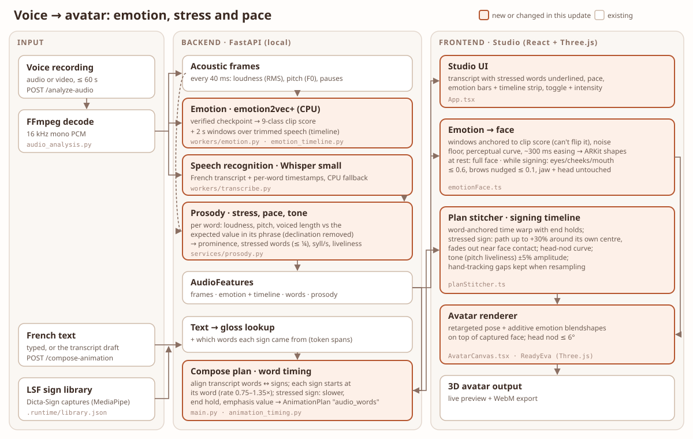
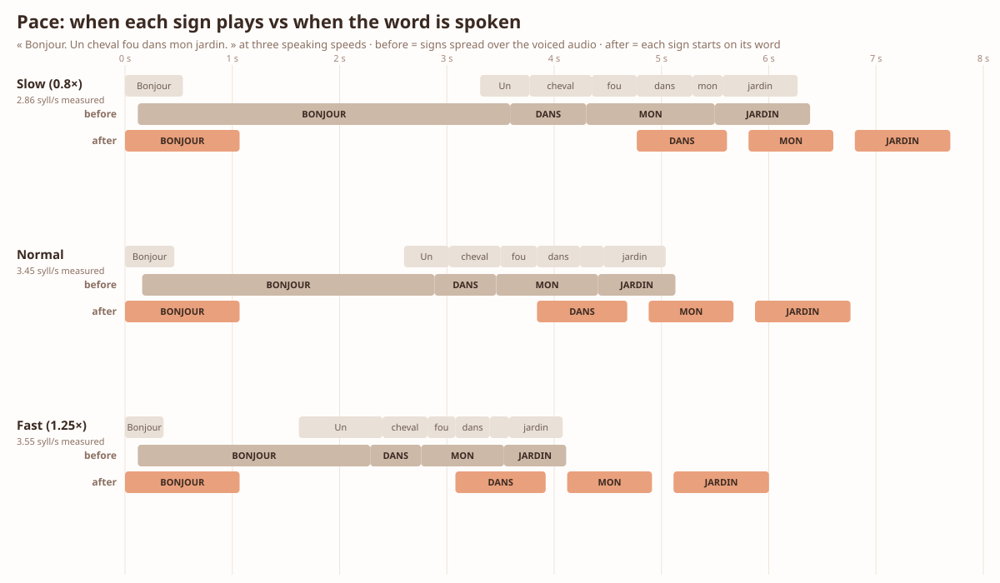

# Voice expression: emotion, stress and pace

How a voice recording now shapes the avatar: the face follows the voice's emotion, stressed words get a stronger sign with a small nod, and each sign starts on its spoken word.

## Pipeline
1. **Decode** (`backend/app/services/audio_analysis.py`): FFmpeg to 16 kHz mono; 40 ms acoustic frames (loudness, pitch, pauses).
2. **Emotion** (`backend/app/workers/emotion.py`, `emotion_timeline.py`): emotion2vec+ with verified checkpoint weights; one clip-level score plus 2 s windows over the trimmed speech.
3. **Transcription** (`backend/app/workers/transcribe.py`): Whisper small, French, per-word timestamps; falls back to CPU when CUDA libraries are missing.
4. **Prosody** (`backend/app/services/prosody.py`): per word, loudness, average pitch and voiced length compared with the value expected at that point of its phrase (declination removed, the judged word left out). Gives prominence, stressed words (at most a quarter), pace in syllables/s and pitch liveliness.
5. **Compose** (`backend/app/main.py`, `services/animation_timing.py`): transcript words are aligned with the signs. When at least half align, `timing_mode: "audio_words"`: each sign starts at its word (playback 0.75–1.35×), and stressed signs are slowed and end with a short hold.
6. **Face** (`frontend/src/utils/emotionFace.ts`): windows are anchored to the clip score (they can strengthen it, never flip it), then mapped to ARKit blendshapes with a noise floor, a perceptual curve and easing. At rest: full face. While signing: eyes, cheeks and mouth corners up to 0.6, brows nudged at most 0.1, jaw and head untouched (LSF grammar).
7. **Signing timeline** (`frontend/src/utils/planStitcher.ts`): word-anchored time warp; stressed signs enlarge their path around their own centre (up to +30 %, fading out near face contact); a head-nod curve (up to 6°); pitch liveliness changes amplitude by up to ±5 %; hand-tracking gaps are preserved when resampling.
8. **Render** (`frontend/src/components/AvatarPlayer/AvatarCanvas.tsx`): additive emotion blendshapes on top of the captured face, plus the nod.

## Results
See [BENCHMARKS.md](BENCHMARKS.md). All emotion and stress outputs are acoustic model estimates, not linguistic annotation or a person's inner state. Head nods and facial cues while signing need review by signers before any public use.

## Reproduce locally
- Models: `bash scripts/setup-models.sh audio`; Whisper model as in `research/audio/ASR_MODEL_SETUP.md`.
- On Windows, run the API with `PYTHONUTF8=1`. The capture library is written as UTF-8.
- Signs for tests: France-LSF Dicta-Sign entries (BONJOUR, DANS, MON, JARDIN, LAC, JE, VOIR, MERCI), captured locally with `scripts/ingest_dictasign.py`'s `extract_entry`. Captures stay in the ignored `.runtime/` folder.
