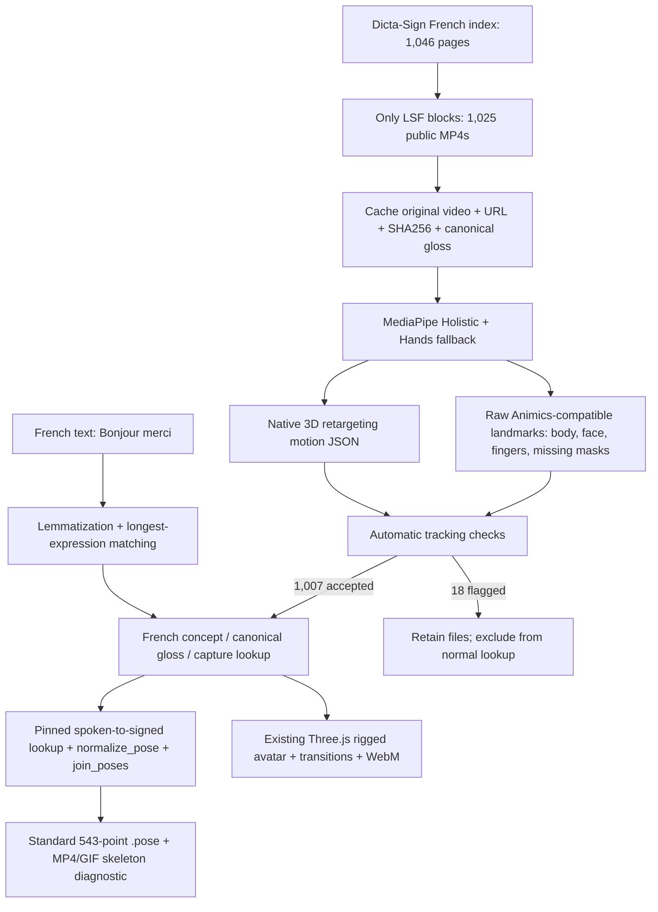

# Dicta-Sign video → gloss → pose pipeline

This is the requested working lexical baseline. The public French concept portal was downloaded locally, its actual LSF recordings were captured with computer vision, and its canonical glosses now resolve to those captures. The completed run contains **1,025 original videos and raw skeleton captures**, with **1,007 admitted to lookup** and **18 retained for tracking review**. The index contains 1,046 concept pages; 21 pages have no LSF MP4. All 1,025 original-video SHA256 checksums were verified. No sentence-training examples were invented.



## What was reused

- [Dicta-Sign public French concepts](https://www.sign-lang.uni-hamburg.de/dicta-sign/portal/concepts/concepts_fre.html): French labels, canonical source glosses, HamNoSys, source pages and **France LSF** video URLs. The BSL, DGS and GSL blocks are excluded.
- [Animics](https://github.com/upf-gti/animics/tree/daf09928fab05f6227d6d0836395d2bddbdebc4f): raw recorder channel names and world-axis conventions, adapted to our Python capture worker. This is not a full port of its current browser engine or its facial AU estimator.
- [spoken-to-signed-translation](https://github.com/sign-language-processing/spoken-to-signed-translation/tree/fec7ac393989f4b6541ab5f860819262a54f27c7): actual `PoseLookup.lookup_sequence`, shoulder normalization and mask-preserving `join_poses`; `pose-format` handles `.pose` serialization and diagnostic rendering. Its default Swiss lexicon and neural pix2pix renderer are not used. Language IDs are `fr` → `fsl`.

The source recordings remain in `.runtime/captures/<capture-id>/source.mp4`. Their `animics-landmarks.json.gz` files preserve native timestamps, 33 body, 468 face and up to 21 points per hand. Missing arrays remain null and become zero-confidence masks in `.pose`; independent world-hand landmarks are unavailable. Original image dimensions preserve aspect ratio. Raw detector estimates are distinct from approximate 3D avatar retargeting.

## Run and inspect

```bash
# First-time runtimes
bash scripts/setup-models.sh motion
.venv/bin/pip install -r scripts/requirements-data.txt
integration/spoken_pipeline/setup.sh

# Small test, then full cached/resumable ingestion
.venv/bin/python scripts/ingest_dictasign.py --concept-ids 380,905 --capture-workers 2
.venv/bin/python scripts/ingest_dictasign.py --all --workers 2 --capture-workers 4
# After an interrupted source/extraction failure, retry failed records only:
.venv/bin/python scripts/ingest_dictasign.py --retry-failed --capture-workers 4

# Explicit local preview export; then actual upstream pose sequence
integration/spoken_pipeline/.venv/bin/python integration/spoken_pipeline/pipeline.py export --library-root "$PWD" --allow-local-preview --output .runtime/lexical_pipeline/lexicon
integration/spoken_pipeline/.venv/bin/python integration/spoken_pipeline/pipeline.py render --lexicon .runtime/lexical_pipeline/lexicon --text 'Bonjour merci' --output artifacts/dictasign/cli-demo

# Browser verification, with a local Chrome installation
CHROME_PATH=/path/to/chrome npm --prefix e2e run test:dictasign
```

In the running Studio, enter **Bonjour merci** and click **Créer l’animation** for the 3D preview. Open **Exporter la chaîne glosses → poses**, then **Générer les poses et le diagnostic** for `.pose`, skeleton video and source report downloads. Bibliothèque displays ingestion counts and exports the machine-readable gloss dataset.

API: `POST /pipeline/lexical` with `{"text":"Bonjour merci"}` produces artifact URLs. `GET /datasets/dictasign/lexicon` exports accepted entries; `GET /captures/<uuid>/landmarks` downloads full raw landmarks. Unknown or canonically ambiguous words stop the upstream sequence with HTTP 422, without a foreign-language or synthetic fallback. Distinct original assets remain accessible even when Dicta-Sign takes lookup priority.

The verified example selects **BONJOUR / cs380** and **MERCI / cs905**, both from Dicta-Sign: **80 frames, 25 fps, 3.2 seconds, 512×512 H.264 MP4**, plus `.pose` and GIF. The browser also records the same captured movements through the existing 3D avatar. The final source and capture report is [dictasign_ingestion_report.json](../../data/source_inventory/dictasign_ingestion_report.json); source inventory and the 21 unavailable LSF entries are alongside it.

## Scope

This fulfills a **lexical retrieval → pose → preview** baseline. Lemmatization and source-order concatenation do not implement LSF grammar or validated coarticulation. This path needs no T5 or GAN training. The diagnostic uses conservative upstream joining; the 3D player uses its separate 333 ms transitions. Automatic capture thresholds are pose coverage ≥80% and at least one hand ≥35%; acceptance is not expert approval of handshape or meaning.

Public lexical videos are separate from the restricted Dicta-Sign-v2 continuous corpus. No restricted corpus was retrieved. Per-asset redistribution rights were not established: originals, poses and preview outputs remain ignored local research artifacts with pending rights. The metadata report is committed, without distributing source recordings.
