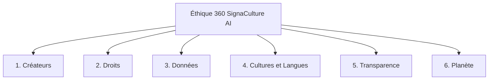

# Cadre Éthique et Responsabilité — SignaCulture AI

> **Cadre :** Hackathon IA Éthique 360 (13–25 novembre 2026)  
> **Document :** Spécification éthique et grille d'évaluation 360° v1.0  
> **Avertissement :** Les fonctionnalités présentées reflètent un prototype MVP de recherche. Aucun label de validation LSF humaine native ni de publication publique définitive n'est revendiqué à ce stade.

---

## 1. Les Six Piliers d'Éthique 360 Appliqués

Le projet SignaCulture AI aborde la synthèse 3D en langue des signes française (LSF) avec une vigilance éthique renforcée. La LSF n'est pas un code gestuel dérivé du français oral, mais une langue vivante, tridimensionnelle, dotée d'une syntaxe spatiale et d'une grammaire faciale rigoureuses.

### Pilier 1 — Créateurs & Humain dans la Boucle
- **Non-substitution :** L'outil est conçu comme une assistance à la pré-production pour l'accessibilité audiovisuelle, et non comme un traducteur automatique autonome prétendant remplacer les interprètes ou traducteurs sourds professionnels.
- **Droit d'arbitrage :** Tout `AnimationPlan` généré est soumis à une interface d'examen (`POST /review`). L'approbation humaine est requise pour tout usage officiel.
- **Interdiction de bypass :** Même après une approbation technique, le système verrouille le rendu public tant que les droits et les validations linguistiques ne sont pas formellement acquis.

### Pilier 2 — Droits & Propriété Intellectuelle
- **Origine documentée :** Chaque mouvement s'appuie sur un `source_id` tracé dans le registre des sources.
- **Respect des licences :** Les corpus de recherche (tels que Dicta-Sign) sont consultés selon leurs conditions d'attribution et ne sont pas aspirés en masse sans convention.
- **Protection des signants :** Les enregistrements vidéo originaux impliquant des personnes physiques nécessitent un consentement éclairé et une convention explicite de droit à l'image.

### Pilier 3 — Données & Vie Privée
- **Minimisation :** Seules les coordonnées squelettiques anonymisées (fichiers JSON cinématiques) sont utilisées dans le moteur d'animation.
- **Ségrégation stricte :** Les données biométriques et flux vidéo bruts identifiables sont conservés hors des dépôts publics, dans des environnements d'archivage sécurisés.

### Pilier 4 — Cultures et Langues LSF
- **Primauté grammaticale :** Les marqueurs non manuels (sourcils, inclinaison de la tête, direction du regard, rythme) constituent des éléments grammaticaux fondamentaux en LSF.
- **Contrainte sur l'expressivité :** L'analyse vocale (prosodie, intonation) ne peut en aucun cas modifier un mouvement de manière à en corrompre la signification lexicale ou la structure syntaxique LSF. En cas de conflit, la contrainte linguistique prévaut systématiquement.
- **Reconnaissance des limites :** La lemmatisation mot-à-mot (Text-to-Gloss) est explicitement documentée comme une approximation limitée, incapable de rendre compte de la spatialité complexe de la LSF.

### Pilier 5 — Transparence & Vérité Scientifique
- **Labellisation visible :** Tout asset de test est formellement marqué `synthetic: true` et `review_status: pending`.
- **Honnêteté des résultats :** Le système refuse les prédictions d'émotion fallacieuses (`emotion_hypothesis: null`) tant qu'un modèle local vérifié et calibré n'est pas intégré.
- **Traçabilité logicielle :** Les versions de rigs (`signaculture-v1`), les modèles de signal et les horodatages sont conservés dans les payloads API.

### Pilier 6 — Planète & Sobriété Numérique
- **Inférence frugale :** Priorité aux algorithmes déterministes légers en traitement du signal (DSP) pour l'analyse de prosodie (RMS, F0 par autocorrélation / zero-crossing) exécutables sur CPU standard.
- **Cible matérielle maîtrisée :** Optimisation pour une exécution locale sur une carte grand public (NVIDIA RTX 4060, 8 Go de VRAM), limitant la consommation énergétique liée aux clusters cloud.

---

## 2. Matrice d'Évaluation : Réalisé vs En Attente

| Dimension Éthique | Mesure Concrète Réalisée (MVP) | Statut Actuel | Étape en Attente (Feuille de Route) |
|---|---|---|---|
| **Contrôle Créateurs** | Endpoint `POST /review` avec rejet / approbation persistée dans SQLite | **Opérationnel** | Interface UI dédiée aux relecteurs sourds avec annotations 3D |
| **Gating de Publication** | Blocage HTTP 403 systématique sur `POST /render` (mode publication) | **Opérationnel** | Déblocage après double validation humaine certifiée (relecteur sourd + droits) |
| **Transparence Données** | Mention explicite `NONVALIDATED_TECHNICAL_FIXTURE` dans les assets | **Opérationnel** | Certification d'un jeu de données issu d'un workshop sourd |
| **Validation Humaine** | Protocole d'évaluation défini (`docs/governance/validation.md`) | **En attente** | Séances de tests utilisateurs avec locuteurs sourds natifs |
| **Vidéo & Démonstration** | Script et narration documentés (`docs/presentation/demo_narration.md`) | **En attente** | Enregistrement studio et validation d'accessibilité de la vidéo |
| **Publication Publique** | Dépôt Git local et CI configurés | **En attente** | Mise en ligne sous réserve d'audit juridique des droits |
