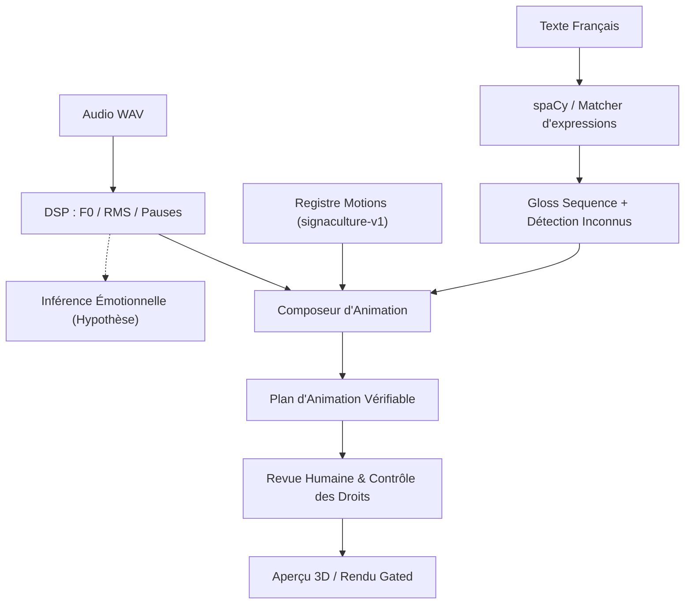

# Méthodologie Scientifique et Technique — SignaCulture AI

> **Document :** Spécification méthodologique v1.0  
> **Cadre :** Hackathon IA Éthique 360  
> **Avertissement :** Ce document détaille l'architecture expérimentale et le protocole d'évaluation. Les étapes d'ablation perceptuelle sur signants humains sont programmées pour la phase de consolidation.

---

## 1. Vue d'Ensemble du Pipeline

SignaCulture AI orchestre une chaîne modulaire découplée permettant de passer d'un texte français (avec signal audio optionnel) à une animation 3D intelligible et contrôlée :

---

## 2. Décomposition des Modules

### 2.1 Traitement Textuel et Lookup de Glosses (Text-to-Gloss)
- **Tokenisation & Lemmatisation :** Réalisées via spaCy (`fr_core_news_sm`) pour normaliser les formes fléchies en concepts canoniques.
- **Priorité aux expressions figées :** Un matcher multi-termes examine d'abord les locutions complexes (ex. "s'il vous plaît") avant de résoudre les lemmes isolés.
- **Gestion des Inconnus (`unknowns`) :** Toute unité lexicale non couverte par le registre restreint est isolée. La réponse API stipule impérativement `translation_validated: false` et `linguistic_review: "pending"`.
- **Règle scientifique :** La lemmatisation n'est pas une traduction syntaxique en LSF. Elle sert uniquement d'indexeur de concepts pour des tests contrôlés.

### 2.2 Analyse Acoustique et Prosodique
- **Signal déterministe (DSP) :** Analyse par fenêtrage de 50 ms (recouvrement de 25 ms) :
  - **Énergie RMS :** Détection de l'intensité vocale et des pauses silencieuses.
  - **Fréquence fondamentale (F0) :** Estimation de la hauteur vocale (testée sur des tons purs 220 Hz et 440 Hz).
  - **Horodatage temporel :** Mesures fournies en millisecondes pour un alignement précis avec les segments gestuels.
- **Couche Affective (Prospective) :** Intégration prévue d'un checkpoint `emotion2vec+`. Dans le MVP actuel, `emotion_hypothesis` demeure strictement `null` tant qu'un modèle local vérifié n'est pas exécuté.

### 2.3 Bibliothèque de Mouvements et Rig `signaculture-v1`
- **Spécification du Rig :** Hiérarchie squelettique normalisée :
  - `head`, `neck`, `hips`
  - `left_shoulder`, `left_elbow`, `left_wrist`
  - `right_shoulder`, `right_elbow`, `right_wrist`
- **Repère :** Coordonnées métriques (Y vers le haut, X vers la droite, Z vers l'avant).
- **Interpolation :** Interpolation linéaire des positions et sphérique (SLERP) des rotations articulaires entre images clés pour éviter les saccades lors du raccordement des segments.

---

## 3. Positionnement Scientifique face à l'État de l'Art (T5-GAN 2026)

Le travail de référence de **Muanji et al. (2026)** (*Signing Avatar Synthesis via a Hybrid T5-GAN Approach: Automatic Speech-to-French Sign Language Translation*, Procedia Computer Science) propose une chaîne neuronale de bout en bout (T5 pour le texte-vers-gloss et GAN pour la synthèse de poses 2D).

| Critère d'Analyse | T5-GAN (Muanji et al. 2026) | SignaCulture AI (Notre Approche) |
|---|---|---|
| **Espace de Rendu** | Poses 2D stylisées (OpenPose / MediaPipe) | Rig squelettique 3D normalisé (`signaculture-v1`) sous WebGL / Three.js |
| **Gouvernance & Droits** | Modèle boîte noire sans registre de droits explicite | Registre traçable des sources, licences et consentements (`source_id`, `motion_id`) |
| **Garde-fous de Publication** | Génération automatique directe | Gating strict (`render_allowed_for_publication: false`) bloquant tout usage public non validé |
| **Prosodie & Voix** | Absent (traduction textuelle pure) | Analyse acoustique temporelle corrélée aux segments signés |
| **Posture Éthique** | Revendication de traduction automatique | Système d'aide à la pré-production avec primauté de la grammaire LSF |

---

## 4. Protocole d'Évaluation Expérimentale (Ablation E1 à E5)

Le plan de validation prévoit 5 expériences comparatives :

- **E1 — Lookup de Gloss :** Comparaison lemmatisation simple vs matcher d'expressions. (Mesure : taux de couverture lexicale et détection des faux appariements).
- **E2 — Extraction Cinématique :** Landmarks bruts vs normalisation et retargeting sur rig 3D standardisé. (Mesure : stabilité des coudes et poignets, détection d'artefacts).
- **E3 — Coarticulation :** Concaténation rigide de clips vs interpolation inter-segments. (Mesure : fluidité perçue et continuité cinématique).
- **E4 — Prosodie :** Avatar neutre vs avatar avec modulation de vitesse indexée sur le rythme vocal. (Mesure : intelligibilité des signes et préservation du sens).
- **E5 — Affect & Émotion :** Prosodie seule vs prosodie combinée à une hypothèse émotionnelle. (Mesure : évaluation par signants natifs des interférences potentielles avec les sourcils grammaticaux).

---

## 5. Matrice Réel vs En Attente

| Composant Méthodologique | Statut MVP Actuel | Statut Cible / En Attente |
|---|---|---|
| **Text-to-Gloss** | Matcher déterministe sur vocabulaire contrôlé | Modèle hybride avec gestion avancée de la syntaxe LSF |
| **Prosodie Audio** | DSP F0 + RMS + détection de silences en ms | Expérimentation d'un modèle local emotion2vec+ |
| **Rig Cinématique** | 9 articulations majeures + interpolation linéaire | Intégration complète des 21 points des doigts et du maillage facial (FACS) |
| **Évaluation Humaine** | Tests unitaires et d'intégration automatisés | Séances de tests perceptuels avec des locuteurs sourds natifs |
