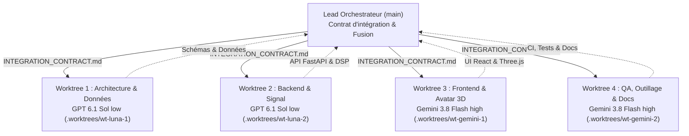

# Organisation en Worktrees de Développement — SignaCulture AI

> **Document :** Spécification d'implémentation multi-worktree v1.1  
> **Objet :** Traduction opérationnelle de l'organisation d'équipe du plan initial en quatre worktrees Git isolés sous la direction d'un lead orchestrateur, sans modifier les objectifs du plan d'origine.  
> **Principe directeur :** Aucun chemin absolu codé en dur ; travail exclusif via des branches et des chemins relatifs au dépôt (`REPO_ROOT`).

---

## 1. Cartographie des Responsabilités et Modèles Effectifs par Worktree

Pour concilier parallélisme strict et cohérence d'intégration, l'implémentation est structurée en **quatre worktrees Git spécialisés** pilotés par le Lead Orchestrateur.

Conformément à la topologie de session et à la correction utilisateur :
- Les chemins historiques des worktrees (`.worktrees/wt-luna-1` et `.worktrees/wt-luna-2`) sont conservés pour assurer la continuité des environnements de travail.
- Les modèles effectifs pour les tâches d'architecture et de backend ont été mis à jour de Codex vers **GPT 6.1 Sol low**.
- Les tâches de frontend et de QA / documentation sont assurées par **Gemini 3.8 Flash high**.

| Tâche / Rôle | Modèle Effectif | Worktree (Relatif) | Branche Git | Périmètres et Fichiers Possédés | Responsabilités Clés |
|---|---|---|---|---|---|
| **Frontend et Lecteur 3D** | Gemini 3.8 Flash high | `.worktrees/wt-gemini-1` | `feat/frontend` | `frontend/**` | - Application React / Vite / TypeScript - Rendu WebGL Three.js sur rig `signaculture-v1` - Visualiseur audio et panneau de révision |
| **QA, Outillage & Documentation** | Gemini 3.8 Flash high | `.worktrees/wt-gemini-2` | `feat/qa` | Racine configs (`Makefile`, `pytest.ini`, etc.) `.github/**` `scripts/**` `docs/**` (hors architecture/contrat) `README.md` | - Scripts locaux reproductibles (`setup`, `dev`, `test`) - GitHub Actions CI unifié sans mocks - Suite de smoke tests contre endpoints réels - Documentation éthique, gouvernance, slides et pitch |
| **Architecture, Schémas & Données** | GPT 6.1 Sol low | `.worktrees/wt-luna-1` *(historique)* | `feat/architecture` | `backend/app/schemas/**` `data/**` `experiments/**` `docs/architecture.md` | - Schémas Pydantic du contrat d'intégration - Registres `glossary.json` et `motions_manifest.json` - Expérimentations d'extraction cinématique |
| **API, Lookup & Signal Audio** | GPT 6.1 Sol low | `.worktrees/wt-luna-2` *(historique)* | `feat/backend` | `backend/app/**` (hors schemas) `backend/tests/**` | - Application FastAPI (`app.main:app`) - Endpoints text-to-gloss et lookup d'inconnus - Traitement acoustique déterministe (DSP) - Base SQLite des revues et logique de gating |
| **Lead Orchestrateur** | Lead coordination | Dépôt racine | `main` | `docs/INTEGRATION_CONTRACT.md` `SignaCulture_AI_Plan_Developpement.md` `ORCHESTRATION.md` | - Contrat d'intégration faisant foi - Fusion et relecture des diffs entre branches - Contrôles d'intégration et gating de release |

---

## 2. Règles d'Isolation et Workflow Git

1. **Isolation stricte :** Chaque agent travaille exclusivement dans son worktree assigné. Aucune modification directe sur les branches voisines.
2. **Chemins relatifs universels :** Les scripts et configurations s'appuient sur la racine Git dynamique (`REPO_ROOT="$(cd "$(dirname "${BASH_SOURCE[0]}")/.." && pwd)"`) sans aucun chemin absolu codé en dur.
3. **Autorité du Contrat d'Intégration :** En cas d'ambiguïté entre branches, le document `docs/INTEGRATION_CONTRACT.md` détenu par le lead est la référence normative absolue.
4. **Protocole de Fusion :**
   - Chaque worktree committe ses fichiers de périmètre sans rebase ni merge non coordonné.
   - Le lead examine les branches et effectue l'intégration sur `main`.
   - La suite de smoke tests (`scripts/smoke_test.py`) valide l'ensemble intégré contre le backend FastAPI réel en fonctionnement.
