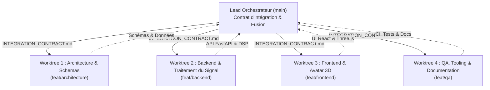

# Organisation en Worktrees de Développement — SignaCulture AI

> **Document :** Spécification d'implémentation multi-worktree v1.0  
> **Objet :** Traduction opérationnelle de l'organisation d'équipe du plan initial en quatre worktrees Git isolés sous la direction d'un lead orchestrateur, sans modifier les objectifs du plan d'origine.  
> **Principe directeur :** Aucun chemin absolu codé en dur ; travail exclusif via des branches et des chemins relatifs au dépôt (`REPO_ROOT`).

---

## 1. Cartographie des Responsabilités par Worktree

Pour concilier parallélisme strict et cohérence d'intégration, les filières initiales (Données A, Vision B, NLP C, Audio D) sont articulées en **quatre worktrees Git spécialisés** pilotés par un Lead Orchestrateur :



---

## 2. Périmètres et Fichiers Possédés (Ownership)

| Worktree / Rôle | Branche Git | Fichiers Possédés Exclusifs | Responsabilités Clés |
|---|---|---|---|
| **Worktree 1 : Architecture & Données** | `feat/architecture` | `backend/app/schemas/**`<br/>`data/**`<br/>`experiments/**`<br/>`docs/architecture.md` | - Schémas Pydantic du contrat<br/>- Registres `glossary.json` et `motions_manifest.json`<br/>- Expérimentations d'extraction cinématique |
| **Worktree 2 : Backend & Signal** | `feat/backend` | `backend/app/**` (hors schemas)<br/>`backend/tests/**` | - Application FastAPI (`app.main:app`)<br/>- Endpoints text-to-gloss et lookup<br/>- Traitement audio déterministe (DSP)<br/>- Base SQLite des revues et logique de gating |
| **Worktree 3 : Frontend & 3D** | `feat/frontend` | `frontend/**` | - Interface React / Vite / TypeScript<br/>- Rendu WebGL Three.js sur rig `signaculture-v1`<br/>- Visualiseur audio et formulaire de révision |
| **Worktree 4 : QA, Tooling & Docs** | `feat/qa` | Racine configs (`Makefile`, `pytest.ini`, etc.)<br/>`.github/**`<br/>`scripts/**`<br/>`docs/**` (hors architecture et contrat)<br/>`README.md` | - Scripts de setup, dev et test reproductibles<br/>- GitHub Actions CI unifié<br/>- Suite de smoke tests contre endpoints réels<br/>- Documentation éthique, gouvernance, slides et pitch |
| **Lead Orchestrateur** | `main` | `docs/INTEGRATION_CONTRACT.md`<br/>`SignaCulture_AI_Plan_Developpement.md` | - Définition de l'API contractuelle faisant foi<br/>- Orchestration des intégrations Git<br/>- Validation finale des releases et livrables |

---

## 3. Règles d'Isolation et Workflow Git

1. **Aucun franchissement de worktree :** Chaque agent travaille exclusivement dans l'espace qui lui est assigné. Aucune modification directe sur les branches voisines.
2. **Pas de chemins absolus codés en dur :** Tous les scripts bash, tests Python et configurations utilisent des résolutions dynamiques relatives :
   ```bash
   REPO_ROOT="$(cd "$(dirname "${BASH_SOURCE[0]}")/.." && pwd)"
   ```
3. **Contrat d'intégration faisant foi :** En cas d'ambiguïté entre implémentations, le fichier `docs/INTEGRATION_CONTRACT.md` détenu par le lead est la source de vérité absolue.
4. **Validation et Intégration :**
   - Chaque worktree committe ses fichiers de périmètre sans rebase ni merge intempestif.
   - Le lead orchestrateur fusionne les branches sur `main`.
   - La suite de smoke tests (`scripts/smoke_test.py`) valide l'ensemble intégré de bout en bout contre l'API FastAPI réelle en fonctionnement.
