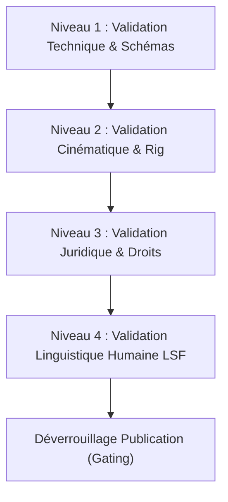

# Stratégie de Validation et Gating de Publication — SignaCulture AI

> **Document :** Protocole de validation et contrôle qualité v1.0  
> **Cadre :** Hackathon IA Éthique 360  
> **Avertissement Formel :** Aucune validation humaine par des signants natifs n'est déclarée comme achevée dans ce document. Le protocole décrit les garde-fous automatisés en place et la méthodologie de certification humaine en attente.

---

## 1. Niveaux de Contrôle Qualité

Le prototype vérifie les fichiers et bloque l'endpoint de publication lorsque les approbations manquent. Les validations linguistiques et cinématiques décrites ci-dessous restent des étapes humaines à réaliser ; le logiciel local ne certifie pas l'identité des réviseurs.



### Niveau 1 — Validation Technique & Schémas (Automatisée en CI)
- **Contrat d'intégration :** Strict respect de [INTEGRATION_CONTRACT.md](INTEGRATION_CONTRACT.md).
- **Gestion des types et temps :** Tous les timestamps sont en millisecondes entières.
- **Suite de Smoke Tests (`scripts/smoke_test.py`) :**
  - Vérification de l'API `/health` (HTTP 200).
  - Validation du lexique `/glossary` et des assets `/motions/{id}`.
  - Détection systématique des tokens inconnus lors du lookup textuel (`translation_validated: false`).
  - Analyse du signal audio WAV synthétique (440 Hz + silence + 220 Hz) : vérification de l'estimation de F0 à ~220 Hz et détection effective des pauses.
  - Sécurité des assets : refus d'accès aux fichiers non enregistrés ou tentatives d'évasion de chemin (`GET /assets/...`).

### Niveau 2 — Validation Cinématique & Rig 3D
- **Conformité `signaculture-v1` :** Présence des 9 articulations indispensables (`head`, `neck`, `hips`, épaules, coudes, poignets).
- **Repère spatial :** Coordonnées en mètres (Y vers le haut, X droite, Z avant).
- **Contrôles actuels :** coordonnées finies, joints déclarés présents et timestamps cohérents. La détection automatique des discontinuités et des inversions anatomiques reste à développer.

### Niveau 3 — Validation Juridique & Droits d'Auteur
- **Attribution des sources :** Chaque mouvement doit être rattaché à un `source_id` documenté dans `data/sources.csv`.
- **Statut des droits (`rights_status`) :** Valeurs autorisées : `"cleared"` ou `"pending"`.
- **Règle d'or :** Tant que `rights_status != "cleared"`, tout rendu public est impossible.

### Niveau 4 — Validation Linguistique LSF (Humains dans la boucle)
- **Critères d'évaluation :**
  1. Configuration des mains (chiremes / cherèmes).
  2. Orientation de la paume et direction du mouvement.
  3. Emplacement dans l'espace de signation (thorax, visage, espace neutre).
  4. Marqueurs non manuels : sourcils, direction du regard, mimique faciale grammaticale.
- **Journal local :** Enregistrement dans SQLite via `POST /review` (`reviewer`, `status`, `notes`). L'API locale n'authentifie pas les réviseurs et ne délivre aucune certification.

---

## 2. Système de Gating de Publication (`POST /render`)

Le contrat d'intégration distingue formellement deux finalités de rendu :

```python
# Aperçu : fichiers vérifiés ; aucun export vidéo applicatif.
return {"plan": plan, "assets": assets, "video_exported": False}
# Publication : HTTP 403 si inconnus, fixtures synthétiques ou approbations manquantes.
# Si tous les contrôles passent : HTTP 501, car l'export vidéo reste à implémenter.
```

### Règle Anti-Bypass
L'approbation isolée d'un réviseur via `POST /review` **ne peut pas outrepasser** le statut des droits ou la revue d'animation. L'interdiction de publication reste active tant que l'ensemble des conditions n'est pas réuni.

---

## 3. Matrice Statut Réel (Actuel) vs En Attente (Pending)

| Processus de Validation | Statut Réel Actuel (MVP) | Statut Cible / En Attente | Preuve / Livrable Associé |
|---|---|---|---|
| **Contrôle d'Intégration API** | Sept scénarios HTTP vérifiés via `scripts/smoke_test.py` | Surveillance continue en production | `python3 scripts/smoke_test.py` (7/7 tests validés) |
| **Gating de Rendu Publication** | Opérationnel : HTTP 403 strict sur toute tentative de publication | Déblocage conditionné par double validation certifiée (relecteur sourd + droits) | Testé dans la suite de smoke tests |
| **Sécurité d'Accès aux Assets** | Opérationnel : blocage 403/404 des assets non approuvés | Quotas et contrôle de session | Endpoint `GET /assets/{filename}` |
| **Revue Linguistique LSF** | **En attente** (protocole défini, statut `pending` par défaut) | Séances d'évaluation avec experts sourds natifs | Grille d'évaluation chiremique et spatiale |
| **Validation Droits Corpus** | Fixtures synthétiques libres (CC0), aucun corpus réel ingéré | Audit juridique formalisé des licences tierces | Registre `data/sources.csv` |
| **Enregistrement Démo Vidéo** | Walkthrough local de 75 s avec voix française de synthèse (`artifacts/SignaCulture_Demo_FR.mp4`) | Enregistrement de la démo 1–2 minutes | Script prêt pour captation finale |
| **Dépôt Public GitHub** | Dépôt Git local et CI configurés | Mise en ligne publique après validation lead | `.github/workflows/ci.yml` configuré |
